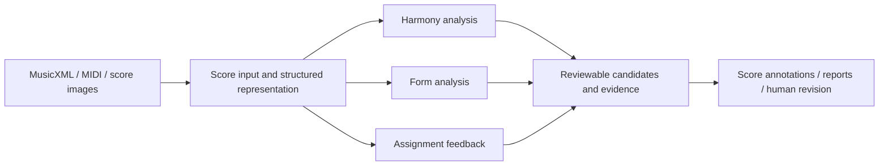

# Xunpu Studio · Portfolio Preview

Music learning, score analysis and reviewable assignment feedback, by Xudong Dai.

This is a **selective portfolio preview**, not the complete product or a deployable service.
It contains public architecture notes, a small offline interface example, and selected evidence.
Production analysis algorithms, prompts, model weights, server routes, credentials, service URLs,
customer records, and private datasets are not included. Examples explicitly marked synthetic are
illustrations, not experimental predictions. No remote API is called by these examples.

## Modules

| Module | Public workflow | Public evidence boundary |
|---|---|---|
| Harmony | Score input → structured events → candidate interpretation → score annotations → human review | Saved historical candidate case on the website; no general accuracy claim |
| Musical form | Score input → measure-aware structure → segment hierarchy → timeline/report → human review | A research/product workflow; automated results require musical checking |
| Assignment feedback | Student score → rubric/context → candidate issues → numbered annotations → learner/teacher review | No public grading-accuracy dataset is released |
| Supporting tools | OMR input, counterpoint, composition and practice | See the website for the wider workbench |

## Architecture

The production modules behind these boxes are private. This diagram describes responsibilities,
not an executable deployment or a claim that one engine handles all inputs perfectly.

## Offline example

`python3 examples/review_contract.py` formats three **synthetic** review candidates.
It demonstrates the review boundary only: it does not recognize a score, classify harmony,
infer musical form, grade an assignment, or connect to the product.

[Website / real demonstration](https://daixudong.art/xunpu/) · [Public evidence notes](docs/EVIDENCE.md)
